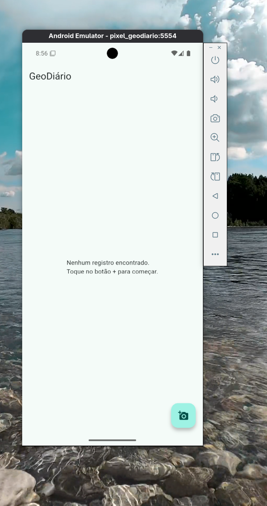
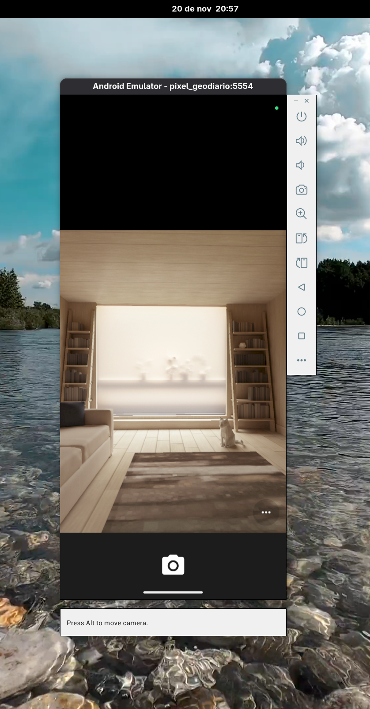
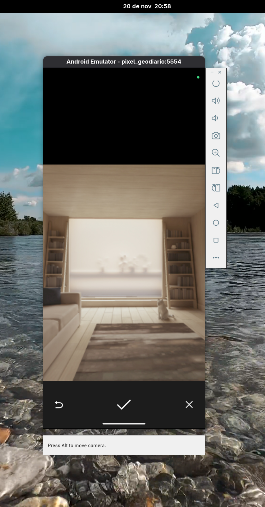
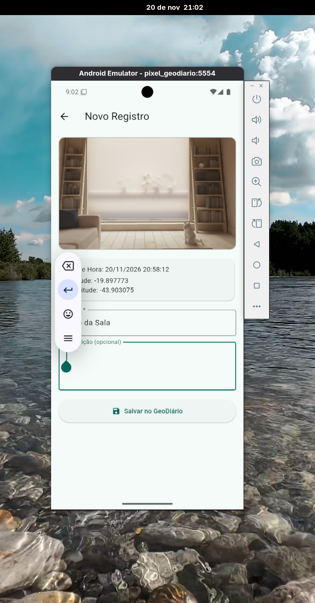
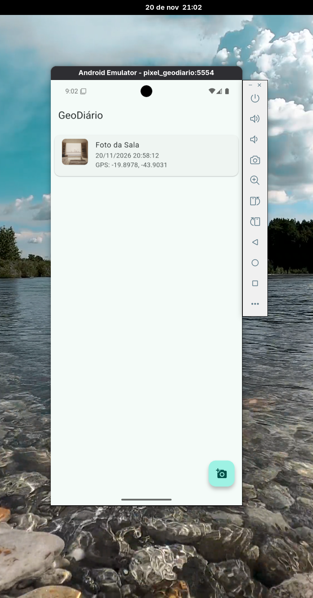
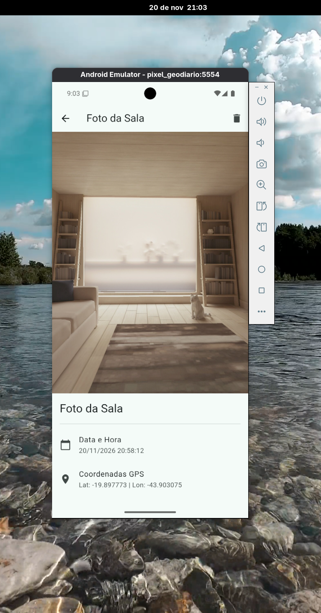
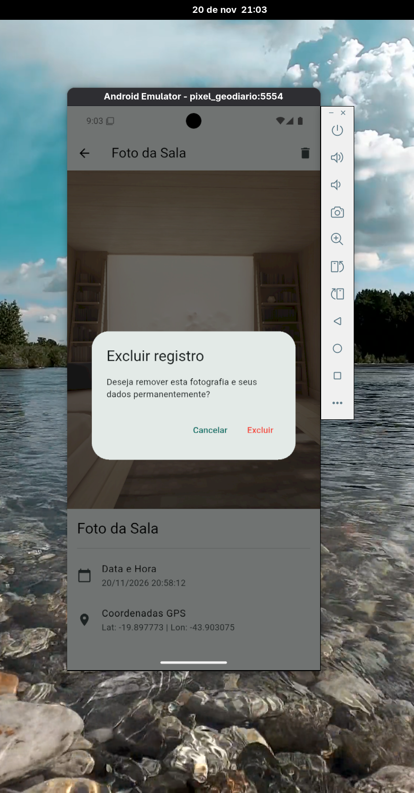

# GeoDiário

Aplicativo mobile desenvolvido em **Flutter** e **Dart** para registro de fotografias associadas automaticamente à data, horário e coordenadas geográficas (latitude e longitude).

## Funcionalidades Implementadas

- **RF01 - Captura de fotografia:** Acionamento da câmera nativa do dispositivo para captura de imagens.
- **RF02 - Informações do registro:** Associação automática de data/hora atual e coordenadas GPS (latitude e longitude), além de título e descrição informados pelo usuário.
- **RF03 - Armazenamento local:** Persistência do arquivo de imagem no diretório local da aplicação e gravação dos metadados e caminho da foto em banco de dados SQLite.
- **RF04 - Consulta dos registros:** Listagem ordenada dos registros salvos com miniatura da foto, título, data/hora e coordenadas.
- **RF05 - Visualização e exclusão:** Tela de detalhes completos do registro com opção de exclusão tanto do banco SQLite quanto do arquivo de imagem armazenado.

## Bibliotecas Utilizadas

- `sqflite`: Persistência local relacional com SQLite.
- `path` & `path_provider`: Manipulação de caminhos e acesso ao diretório local do aplicativo.
- `image_picker`: Integração com a câmera do dispositivo.
- `geolocator`: Obtenção de permissões e coordenadas geográficas via GPS.
- `intl`: Formatação de data e hora.

## Estrutura da Tabela SQLite

Banco de dados: `geodiario.db` | Tabela: `registros`

| Coluna | Tipo | Restrições | Descrição |
| :--- | :--- | :--- | :--- |
| `id` | `INTEGER` | `PRIMARY KEY AUTOINCREMENT` | Identificador único do registro |
| `titulo` | `TEXT` | `NOT NULL` | Título do registro fotográfico |
| `descricao` | `TEXT` | — | Breve descrição opcional |
| `caminho_imagem` | `TEXT` | `NOT NULL` | Caminho absoluto da foto no armazenamento local |
| `data_hora` | `TEXT` | `NOT NULL` | Data e hora da captura (`dd/MM/yyyy HH:mm:ss`) |
| `latitude` | `REAL` | `NOT NULL` | Latitude obtida pelo GPS |
| `longitude` | `REAL` | `NOT NULL` | Longitude obtida pelo GPS |

## Capturas de Tela

| Início GeoDiario | Captura | Confirmação |
| :---: | :---: | :---: |
|  |  |  |

| Novo Registro (Câmera + GPS) | Listagem de Registros (SQLite) |
| :---: | :---: |
|  |  |

| Visualização de Detalhes | Confirmação de Exclusão |
| :---: | :---: |
|  |  |
